  

## Tech Stack

**Languages**

**Backend & Integration**

   

### Databases & Messaging

**Tools & Platforms**

## Interests & Current Focus

## GitHub Activity

  

## Connect

I'm open to **junior software developer opportunities** and collaborating on interesting projects.

---

Keep learning. Keep building.

